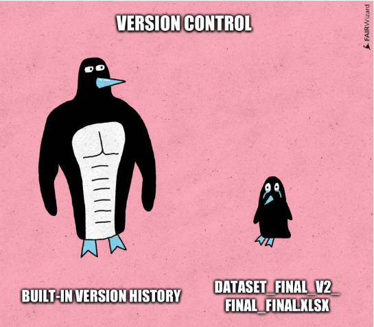

# 🐍💖 Git & GitHub para as PyLadies Bioinfo

Um tema muito importante na ciência é a reprodutibilidade! E na bioinfo não é diferente: a documentação é fundamental, e fazé-lo corretamente é tão importante quanto ela mesma ;) 

 

Material de uma aula introdutória de **Git e GitHub para estudantes de bioinformática**, com teoria e prática. Cada passo é feito de dois jeitos: **no terminal** e **no VS Code**.

---

## 📂 O que tem aqui

| Arquivo | O que é |
|---|---|
| [`aula-git-github.pptx`](aula-git-github.pdf) | Apresentação da aula (35 slides, com notas para quem apresenta) |
| [`aula_git_github_bioinfo.ipynb`](aula_git_github_bioinfo.ipynb) | Caderno prático para o Google Colab, com seções de github.dev e GitHub Codespaces |
| [`cola-git-github.md`](cola-git-github.md) | Cola de comandos para consultar durante e depois da aula |

---

## 🎯 O que você vai aprender

- Por que controlar versões e qual a diferença entre **Git** e **GitHub**
- O ciclo do dia a dia: `git status`, `git add`, `git commit`, `git log`
- Usar o `.gitignore` para deixar dados brutos (FASTQ, BAM), resultados e senhas fora do repositório
- Publicar e sincronizar com o GitHub: `git push`, `git pull`, `git clone`
- Criar branches, fazer merge e resolver conflitos
- Abrir um **Pull Request** a partir de um fork
- Desfazer os erros mais comuns sem perder trabalho
- Como organizar uma pasta com um exemplo usado em toda a aula, como um mini projeto   

---


## 🚀 Como usar

### Antes da aula
- Instale o [Git](https://git-scm.com/downloads) e o [VS Code](https://code.visualstudio.com/)
- Crie uma conta no [GitHub](https://github.com/)
- Confira a instalação no terminal:
  ```bash
  git --version
  ```

### Caderno no Google Colab
1. Abra o [Google Colab](https://colab.research.google.com/)
2. **Arquivo → Abrir notebook → GitHub** e cole o link deste repositório, *ou* faça o download de `aula_git_github_bioinfo.ipynb` e use **Arquivo → Fazer upload de notebook**
3. Rode as células em ordem (`Shift + Enter`)

> ⚠️ O Colab apaga tudo quando a sessão termina. Por isso o caderno ensina a enviar o trabalho para o GitHub.

### Sem instalar nada
- **github.dev:** na página de qualquer repositório, aperte a tecla **`.`** (ponto) para abrir um VS Code no navegador. Serve para editar e commitar, mas não tem terminal.
- **GitHub Codespaces:** botão verde **Code → Codespaces → Create codespace**. Abre uma máquina Linux na nuvem com VS Code completo e terminal. As contas pessoais têm uma cota mensal grátis. Lembre de **parar ou apagar** o codespace ao terminar.

---

## 📚 Para continuar estudando

- [Pro Git](https://git-scm.com/book/pt-br/v2): livro gratuito, em português
- [Learn Git Branching](https://learngitbranching.js.org/?locale=pt_BR): jogo visual para entender branches
- [GitHub Skills](https://skills.github.com): cursos interativos do GitHub
- [Software Carpentry: Version Control with Git](https://swcarpentry.github.io/git-novice/): pensado para pesquisadores
- [Oh Shit, Git!?](https://ohshitgit.com/pt_BR): como consertar os erros mais comuns

---

## 👩‍🏫 Autoria

Material preparado com :yellow_heart: pelas PyLadies [Dra. Natalia Coutouné](nat.coutoune@gmail.com), [MSc. Juliana Félix](juliana.felix@unesp.br) e [MSc. Wendy Abregu](tabregu70@gmail.com). Nossos agradecimentos especiais à [Dra. Bruna Piereck](https://www.vibtrainingandconferences.be/trainer/bruna-piereck) que nos ajudou a criar e ordenar o conhecimento para este tópico num treinamento prévio :blue_heart:. 

Dúvidas e sugestões são bem-vindas: abra uma [Issue](../../issues) ou mande um Pull Request 💬
